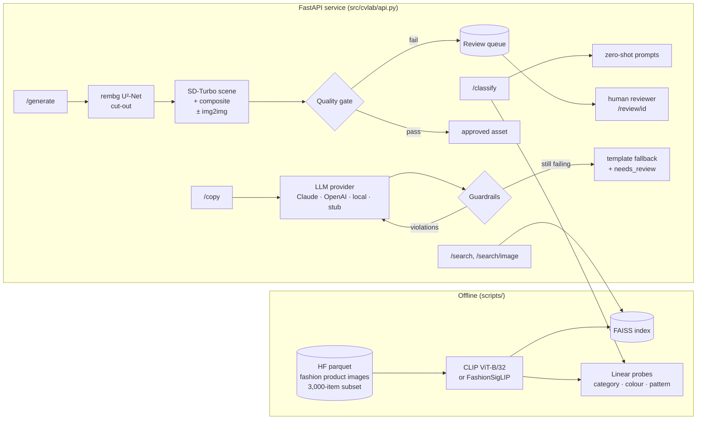

# commerce-vision-lab

> **Learning project, not used by a real brand.** I built this to get hands-on with
> computer vision and generative imaging for apparel e-commerce. It runs on a laptop
> against a public dataset. It has no users, no production traffic and no cloud
> deployment. "Northlight" is a made-up brand name used for the copy guardrails.

The project is a small, production-shaped Python service covering four jobs an apparel catalog team needs:

| Module | What it does | Where |
|---|---|---|
| **Product understanding** | CLIP / SigLIP image embeddings; **zero-shot** and **linear-probe** classification of category, colour and pattern | `src/cvlab/embeddings.py`, `classify.py` |
| **Visual + text search** | FAISS index; text→image and image→image product search; recall@k / precision@k eval | `src/cvlab/search.py` |
| **Product image generation** | Background removal (rembg/U²-Net), lifestyle scene from **SD-Turbo** (diffusers, local on Apple-silicon MPS), composite, optional img2img harmonisation. Then an **automated quality gate** (prompt alignment, mask IoU, product CLIP similarity, product SSIM, colour ΔE) and a **human-review queue** for anything that fails | `src/cvlab/generation/` |
| **LLM product copy** | Alt text + description from structured attributes through a provider interface (Claude, OpenAI, local HF model, deterministic stub), with **guardrails** (no unsupported materials or claims, colour consistency, competitor/brand terms, alt-text rules), one repair round, and a safe template fallback | `src/cvlab/copywriting/` |
| **Service** | FastAPI: `/classify`, `/search`, `/search/image`, `/generate`, `/copy`, `/review/*`; Docker; CI | `src/cvlab/api.py`, `Dockerfile`, `.github/workflows/ci.yml` |

Every model sits behind a small interface with a deterministic stub, so the API and the
test suite run without torch or any model download. CI installs only the core package.

## Architecture



AWS design notes (S3, ECS/Fargate, SQS GPU workers, DynamoDB review queue, pgvector/OpenSearch) are in [docs/aws-deploy.md](docs/aws-deploy.md). They are notes only; nothing was deployed.

## Results

Every number below was produced by the scripts in `scripts/` on an Apple M5 MacBook
(16 GB RAM, PyTorch MPS). The raw outputs, with seeds, sample sizes, model ids and
timings, are committed in [`results/`](results/). The tables are generated from those
files by `python scripts/results_table.py`. These are small-sample measurements on a
public dataset, not benchmarks.

### Classification

| Task (classes, test n) | Majority baseline | clip-vit-b32 zero-shot | clip-vit-b32 linear probe | fashion-siglip zero-shot | fashion-siglip linear probe |
|---|---|---|---|---|---|
| category (25, 900) | 0.069 | 0.690 / 0.694 | 0.851 / 0.849 | 0.763 / 0.770 | 0.871 / 0.863 |
| colour (10, 749) | 0.287 | 0.710 / 0.707 | 0.797 / 0.762 | 0.784 / 0.762 | 0.800 / 0.757 |
| pattern (4, 178) | 0.455 | 0.865 / 0.842 | 0.882 / 0.865 | 0.843 / 0.822 | 0.910 / 0.894 |

Cells are accuracy / macro-F1. Embedding cost: clip-vit-b32 5.03 ms/image (512-d); fashion-siglip 13.95 ms/image (768-d)

### Search

| Query set | Metric | clip-vit-b32 | fashion-siglip |
|---|---|---|---|
| Text: listing title -> that item (any item with the same title) | recall@1 | 0.251 | 0.332 |
| Text: listing title -> that item (any item with the same title) | recall@5 | 0.539 | 0.651 |
| Text: listing title -> that item (any item with the same title) | recall@10 | 0.685 | 0.766 |
| Text: shopper query "<colour> <type>" | precision@10 | 0.503 | 0.547 |
| Image: re-cropped/mirrored/brightened copy -> original | recall@1 | 0.978 | 0.992 |
| Image: re-cropped/mirrored/brightened copy -> original | recall@5 | 0.998 | 1.000 |
| Image: similar items, same type | precision@10 | 0.791 | 0.801 |
| Image: similar items, same type + colour | precision@10 | 0.239 | 0.258 |

Catalog 3000 items, index `faiss` (exact inner product); 2689 title queries, 152 attribute queries, 500 image queries.

### Generation

| Variant (test n) | Gate pass rate | Product SSIM | Colour ΔE | Mask IoU | Product CLIP sim | Prompt margin | Seconds/image |
|---|---|---|---|---|---|---|---|
| composite (20) | 80.0% | 0.999 | 0.08 | 0.975 | 0.999 | 0.109 | 5.58 |
| harmonized@0.35 (20) | 0.0% | 0.644 | 8.80 | 0.954 | 0.829 | 0.131 | 11.85 |
| control@0.8 (20) | 0.0% | 0.538 | 12.97 | 0.891 | 0.765 | 0.155 | 8.84 |

Calibrated thresholds (calibration split): mask_iou 0.9572, product_similarity 0.9485, product_ssim 0.8413, colour_delta_e 3.9113; prompt_margin 0.03 (a priori). Failed checks on test: composite: {'mask_iou': 4, 'prompt_margin': 1}; harmonized@0.35: {'mask_iou': 8, 'product_similarity': 20, 'product_ssim': 19, 'colour_delta_e': 20}; control@0.8: {'mask_iou': 17, 'product_similarity': 20, 'product_ssim': 19, 'colour_delta_e': 20}.

### Copy

| System prompt | First draft: any violation | Most common | Accepted first draft | Accepted after 1 repair | Fell back to template | Final violations | s/product |
|---|---|---|---|---|---|---|---|
| guarded | 4.0% | hallucinated_material 4.0%, colour_mismatch 1.0% | 96.0% | 0.0% | 4.0% | 0.0% | 0.94 |
| minimal | 30.0% | hallucinated_material 22.0%, unsupported_claim 10.0%, alt_text_missing_colour 2.0% | 70.0% | 1.0% | 29.0% | 0.0% | 1.61 |

Provider `local:Qwen/Qwen2.5-0.5B-Instruct`, 100 test-split products.

## Reading the results honestly

- **Dataset.** I used [Fashion Product Images (Small)](https://www.kaggle.com/datasets/paramaggarwal/fashion-product-images-small), which Kaggle lists as MIT, through a [384×512 re-host on Hugging Face](https://huggingface.co/datasets/benitomartin/fashion-product-images-small-384x512). The subset is 3,000 apparel/footwear items, stratified over 25 article types (≤250 each), and is cached in `~/.cache/cvlab`. No images are committed.
- **Splits.** Train/test splits are by product id (70/30). Linear probes never see test products.
- **Pattern labels are weak.** The dataset has no pattern field. An item gets a label only when its title contains exactly one of *striped / checked / printed / solid*, which covers 616 of 3,000. Plain items rarely say "solid", so this task is easier and noisier than a real pattern taxonomy.
- **FashionSigLIP caveat.** Marqo lists KAGL (a version of this Kaggle dataset) among its evaluation sets. I could not confirm from the model card that it was kept out of training, so treat FashionSigLIP's numbers as possibly optimistic. Generic CLIP ViT-B/32 (LAION-2B) is the cleaner baseline.
- **Search.** Titles repeat (e.g. "Puma Men Black T-shirt"), so a title query counts as a hit when *any* item with that exact title is retrieved; queries are deduplicated. The near-duplicate image test is a robustness check and is expected to be high. The "similar items, same type + colour" row is the harder relevance definition.
- **Generation labels come from construction, not human judgement.** `composite` (product pixels untouched) is treated as acceptable and `control@0.8` (heavy img2img) as unacceptable. Gate thresholds for the preservation checks were fitted on a separate calibration split of 10 products, then applied unchanged to the 20 test products. With n=20, read the pass rates as ±~10 points.
- **What the generation numbers say.** Whole-image img2img with SD-Turbo, even at strength 0.35, changes the garment (and redraws the model's face) enough that the product-fidelity checks reject every image. A global CLIP similarity alone barely notices this, which is why the gate also measures SSIM and ΔE inside the product mask. The practical design that follows: generate or harmonise the *scene* only and keep the product's pixels fixed (composite or masked inpainting), then gate. Most composite failures were rembg re-segmenting the product against a busy generated background (mask IoU), and those go to the review queue.
- **LLM copy numbers come from a 0.5B local model, not Claude or OpenAI.** No API keys were used in this project. `Qwen2.5-0.5B-Instruct` runs locally so the guardrail metrics come from real LLM output at zero cost. The Anthropic and OpenAI providers are implemented but have **not** been run here, so there are no numbers for them. The "minimal" row is an ablation: the same model with no content rules in its prompt.
- **Guardrails are rules, not understanding.** They catch the failure types listed in `guardrails.py` (materials, claims, colours, competitor names, alt-text format) and miss paraphrases outside those lists. For example, one flagged guarded-prompt draft also said a top was "designed to keep you cool and dry", a performance claim the rules did not catch. Every violation in the logged examples was a real one, but I did not label a full sample, so guardrail recall is unmeasured. Repair rarely worked with a 0.5B model; failing drafts mostly fell through to the safe template, which is the intended behaviour.

## Run it

```bash
# Python 3.11 or 3.12
uv venv -p 3.11 && source .venv/bin/activate
uv pip install -e ".[dev]"            # core: API + tests with stub backends
pytest                                 # fast, no models
uvicorn cvlab.api:app --reload         # CVLAB_BACKEND=stub by default
```

Real models and the eval scripts (first run downloads a ~140 MB dataset slice, CLIP, FashionSigLIP, U²-Net, SD-Turbo and Qwen2.5-0.5B, about 5 GB in total, into the usual caches):

```bash
uv pip install -e ".[gen,llm,dev]"
python scripts/eval_classification.py   # -> results/classification.json
python scripts/eval_search.py           # -> results/search.json
python scripts/eval_generation.py       # -> results/generation.json (+ images in artifacts/)
python scripts/eval_copy.py             # -> results/copy_local.json
python scripts/results_table.py         # README tables
CVLAB_BACKEND=real uvicorn cvlab.api:app
```

To use a hosted LLM for `/copy`, set `CVLAB_LLM=anthropic` (credentials from
`ANTHROPIC_API_KEY` or an `ant auth login` profile; default model `claude-opus-5-5`) or
`CVLAB_LLM=openai` with `CVLAB_OPENAI_MODEL`.

Docker:

```bash
docker build -t cvlab . && docker run -p 8000:8000 cvlab                 # stub backends
docker build -t cvlab-ml --build-arg EXTRAS=ml,gen,llm .                 # real models (large)
```

### API sketch

```bash
curl -F image=@shirt.jpg localhost:8000/classify
curl -H 'content-type: application/json' -d '{"text":"black heels","k":5}' localhost:8000/search
curl -F image=@shirt.jpg -F product_desc="a navy checked shirt" -F scene=studio localhost:8000/generate
curl -H 'content-type: application/json' -d '{"category":"Tops","colour":"Black"}' localhost:8000/copy
curl localhost:8000/review/pending
```

## Engineering notes

- **Optional extras keep CI fast.** Core installs `fastapi, numpy, pillow, pydantic`. torch, open_clip, diffusers, rembg and transformers are imported lazily inside the real implementations, and CI asserts that `import cvlab.api` does not pull in torch.
- **faiss next to torch on macOS.** Both bundle libomp, and multi-threaded faiss segfaults in the same process. The index pins faiss to one OpenMP thread on macOS. `eval_search.py` checks faiss top-10 against a numpy brute-force search (agreement 1.0).
- **SD-Turbo on MPS** runs in fp32 to avoid fp16 NaN/black images: 1 step for text→image, 2–3 steps for img2img, 512×512. End-to-end seconds per image (segmentation + generation + gate) are in the table. They roughly doubled between my two full runs (composite 2.3 s → 5.6 s) because of other load on the laptop, so treat them as rough.
- **Linear-probe inference is numpy.** sklearn trains the probes, the weights are saved as JSON, and the service needs no sklearn.

## Licences

Code: MIT. Models used at runtime keep their own licences: OpenCLIP ViT-B/32 LAION-2B (MIT), Marqo-FashionSigLIP (Apache-2.0), Qwen2.5-0.5B-Instruct (Apache-2.0), U²-Net via rembg, and SD-Turbo (Stability AI Community License; see its model card before any commercial use).
